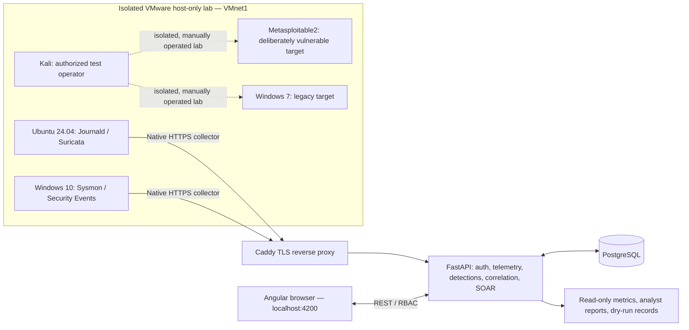

# PurpleForge AI

**VMware-first Purple-Team Security Operations, Detection Validation & Human-Approved Response Platform**

> **Status:** P1–P20 source milestones implemented in the development roadmap. Selected end-to-end workflows have been exercised in a controlled VMware laboratory; see [Validated scope and limitations](#validated-scope-and-limitations). This repository is a research/portfolio lab platform, **not** a production-certified SIEM, EDR, or autonomous offensive system.
>
> **Infrastructure:** Native Windows and Linux services + VMware Workstation. **No Docker / Docker Compose required.**

## Contents

- [Overview](#overview)
- [Problems addressed and real-world value](#problems-addressed-and-real-world-value)
- [System architecture and security boundaries](#system-architecture-and-security-boundaries)
- [Technology stack](#technology-stack)
- [Implemented milestones P1–P20](#implemented-milestones-p1p20)
- [Repository structure](#repository-structure)
- [Prerequisites](#prerequisites)
- [Quick start — Windows development host](#quick-start--windows-development-host)
- [Fresh-install database and authentication notes](#fresh-install-database-and-authentication-notes)
- [VMware laboratory and network design](#vmware-laboratory-and-network-design)
- [Ubuntu telemetry setup and verification](#ubuntu-telemetry-setup-and-verification)
- [Windows 10 Sysmon and Security collection](#windows-10-sysmon-and-security-collection)
- [Suricata, tcpdump, and optional Zeek](#suricata-tcpdump-and-optional-zeek)
- [Kali, Metasploitable2, and Windows 7 lab roles](#kali-metasploitable2-and-windows-7-lab-roles)
- [End-to-end live demonstration](#end-to-end-live-demonstration)
- [Tests, quality gates, and release evidence](#tests-quality-gates-and-release-evidence)
- [Security controls and threat model](#security-controls-and-threat-model)
- [Troubleshooting](#troubleshooting)
- [Performance considerations](#performance-considerations)
- [Validated scope and limitations](#validated-scope-and-limitations)
- [Interview presentation guide](#interview-presentation-guide)
- [Future work](#future-work)
- [Responsible usage and contribution](#responsible-usage-and-contribution)

## Overview

PurpleForge AI connects a **real isolated cyber range** with an analyst-focused workflow: **asset inventory → native telemetry collection → detection rules → validation → incidents and hunting → IOC enrichment → correlation → evidence-grounded reports → separately approved SOAR dry-runs → evidence-based evaluation**.

The goal is to answer practical blue-team/purple-team questions:

1. **What systems are in the lab and which collectors are actually reporting?**
2. **Did a reproducible action on a guest produce telemetry?**
3. **Did a particular detection rule fire on that *exact* event?**
4. **Can an analyst trace findings, indicators, anomalies, and cases back to source evidence?**
5. **Can response proposals be reviewed, approved by a different user, and rehearsed without modifying systems?**
6. **What outcomes are truly measured, and what remains unverified?**

“AI” currently refers to the **P15 Isolation Forest anomaly model** and evidence-grounded investigation workflows. P10/P16 analyst report composition is **deterministic**, not an external LLM integration.

## Problems addressed and real-world value

| Operational problem | PurpleForge approach | Why it matters |
|---|---|---|
| Fragmented host/network visibility | Normalized Windows, Linux, and Suricata telemetry in PostgreSQL | Gives analysts one place to inspect evidence |
| Alerts without demonstrable effectiveness | P4 detection rules + P13 marker runs + P14 exact-event comparison | Distinguishes *telemetry observed* from *detection triggered* |
| Noisy, high-volume logs | Bounded search, aggregation, anomaly analysis, and manual evaluation | Limits memory/CPU usage and makes triage reproducible |
| Weak investigation traceability | Linked event IDs, findings, IOC matches, cases, timelines, reports | Supports evidence-based conclusions and review |
| Risky one-click automation | Separate-user P11 approval and P12 simulation-only execution/closure | Demonstrates separation of duties and safe response design |
| Overstated security metrics | P18/P20 dashboards sourced from stored evidence | Prevents invented coverage or unsupported production-readiness claims |

**Real-world applicability:** SOC engineering, detection engineering, purple-team validation, cyber-range training, research prototyping, and portfolio/interview demonstrations. Additional engineering and assurance are required before any production deployment.

## System architecture and security boundaries



**Trust boundaries and data flow**

1. Register assets and collectors under authorized accounts; issue a **per-source collector key**. A collector key is shown once and must be stored securely.
2. Linux/Windows agents read native logs and submit structured event batches through the HTTPS gateway using `X-Collector-Key`. The server authenticates the source, binds it to the registered asset, normalizes fields, and persists events.
3. Angular communicates with FastAPI under the app's authentication and role checks. Ordinary registration defaults to `Viewer`; it **must not** accept an arbitrary client-supplied administrative role.
4. P4 creates findings from selected telemetry; P13 verifies a run using the **same asset, exact marker, type, and ingestion-time constraints**; P14 compares the selected rule against the run's **exact recorded event ID**.
5. P6–P10/P16 build investigation context from stored evidence. P15 performs a **manually initiated** statistical analysis; anomalies are not automatically attacks.
6. P11 records proposals, requires approval by a **different authorized user**, and executes *dry simulations only*. P12 records hypothetical rehearsal closure; it **does not** roll back a real VM or firewall.
7. P17 stores operator-reported VMware readiness and checks actual telemetry freshness. It does not independently query VMware Workstation's live power state.
8. P18–P20 expose read-only, bounded summaries and final release-evidence snapshots; no continuous polling is required.

## Technology stack

| Layer | Technologies and concepts |
|---|---|
| Frontend | Angular, TypeScript, HTML/CSS, standalone components, REST integration |
| Backend | Python 3.12, FastAPI, Pydantic, SQLAlchemy, Alembic |
| Database | PostgreSQL, indexed event storage, evidence foreign keys and audit history |
| Auth & API | Role-based access control (RBAC), session/token authentication, CORS, defensive HTTP headers |
| Secure ingestion | Caddy TLS reverse proxy, local lab CA, per-collector authentication header |
| Linux telemetry | systemd-journald, native Python systemd service, Suricata EVE JSON |
| Windows telemetry | Sysmon Operational log, Windows Security event log, PowerShell scheduled collectors |
| Network investigation | Suricata, tcpdump, optional offline Zeek analysis, Wireshark as optional viewer |
| Machine learning | scikit-learn Isolation Forest, time-bucket feature engineering |
| Testing/quality | pytest, Angular production build, Alembic revision checks, PowerShell test runners |
| Infrastructure | VMware Workstation, VMnet1 host-only network, native Windows/Linux installations |

> Some tools such as Zeek, tcpdump, Kali, and Metasploitable2 are **lab capabilities or optional manual exercises**, not proof of a native PurpleForge ingestion integration. They must be connected and tested separately before claiming integrated coverage.

## Implemented milestones P1–P20

| Phase | Module | Primary deliverable |
|---|---|---|
| P1 | Platform foundation | FastAPI/Angular baseline, authentication, role model |
| P2 | Lab inventory | Assets, lab/network topology and registration |
| P3 | Native telemetry | Linux Journald, Windows Sysmon/Security and Suricata collector flows |
| P4 | Detection engineering | Deterministic rule management, finding evaluation |
| P5 | Validation & ATT&CK context | Analyst-driven scenario evidence and observed validation |
| P6 | Incidents | Case triage, linked findings, notes and workflows |
| P7 | Threat hunting | Bounded historical searches, saved hunts, IOC lookup, evidence linking |
| P8 | Threat intelligence | Reviewed IOC registration and historical telemetry matches |
| P9 | Correlation | Same-asset correlation cases, evidence timelines, risk explanations |
| P10 | SOC analyst drafts | Deterministic evidence-grounded summaries and human review |
| P11 | SOAR | Allowlisted advisory playbooks, separate-user approval, dry simulation |
| P12 | Response rehearsal | Approved dry-run records, hypothetical rollback closure/audit |
| P13 | Manual lab simulation | Unique marker, operator-run Ubuntu event, exact evidence verification |
| P14 | Detection coverage | Exact P13 evidence ↔ P4 finding validation and observed detection rate |
| P15 | Anomaly detection | Bounded per-asset Isolation Forest time-bucket analysis |
| P16 | Investigation assistant | Evidence-linked P15/P9 drafts, limitations and analyst acceptance |
| P17 | VMware readiness | Operator-reported power/network + recent collector receipts |
| P18 | Operations Center | Unified read-only operational summary with manual refresh |
| P19 | Security Assurance | Defensive headers, admin posture checks, RBAC tests and verification script |
| P20 | Final Evaluation | Admin-only evidence snapshot, reproducible release checks/report template |

## Repository structure

The following reflects the **key paths used in the phased releases**, not a claim to enumerate every file in your locally customized repository.

```text
PurpleLoop/
├── backend/
│   ├── main.py                     # FastAPI app/router registration
│   ├── models.py                   # SQLAlchemy models
│   ├── config.py                   # Settings (check your local config)
│   ├── auth/  api/  telemetry/  detections/  validation/
│   ├── incidents/  hunting/  intelligence/  correlation/
│   ├── analyst/  soar/  response/  simulation/  coverage/
│   ├── anomaly/  investigation/  vmware_range/  operations/
│   ├── assurance/  release/
│   ├── migrations/versions/        # Alembic revisions through P17
│   ├── alembic.ini
│   └── .venv/                      # Local only; do not commit
├── frontend/
│   ├── src/main.ts                 # Root application/navigation
│   ├── src/p13-simulation.component.ts
│   ├── src/p14-coverage.component.ts
│   ├── src/p15-anomaly.component.ts
│   ├── src/p16-investigation.component.ts
│   ├── src/p17-vmware-range.component.ts
│   ├── src/p18-operations.component.ts
│   ├── src/p19-assurance.component.ts
│   ├── src/p20-release.component.ts
│   └── package.json
├── tests/                           # Phase unit/integration tests
├── scripts/p19_verify.ps1
├── scripts/p20_verify.ps1
├── docs/P20_EVALUATION_TEMPLATE.md
├── requirements-p15.txt
└── README.md
```

## Prerequisites

**Development machine (Windows):** VMware Workstation, Python **3.12** with `venv`/`pip`, Node.js/npm compatible with your Angular version, PostgreSQL, Git, PowerShell, and your existing Caddy/HTTPS proxy if using guest telemetry. Recommended: a dedicated host-only lab network with no untrusted uplink.

**Guest machines:** Ubuntu 24.04 and Windows 10 for the verified core telemetry demonstrations. Kali, Metasploitable2 and Windows 7 are optional isolated targets/operators. Legacy and deliberately vulnerable guests **must not be bridged onto a production or Internet-connected network**.

**Example lab addressing (from this project):**

| System | Address | Role |
|---|---|---|
| VMware Windows development host, VMnet1 | `192.168.37.1` | Angular, FastAPI, PostgreSQL, Caddy |
| Ubuntu 24.04 | `192.168.37.20` | Linux telemetry + Suricata sensor |
| Windows 10 | `192.168.37.128` | Sysmon + Security Event collection |
| Kali | `192.168.37.155` | Controlled test operator |
| Metasploitable2 | `192.168.37.129` | Isolated vulnerable target |
| Windows 7 | `192.168.37.131` | Isolated legacy target |

> These are **example asset-inventory addresses**; validate each guest's actual interface address before testing. The Windows host's VMnet1 adapter is different from any guest adapter.

## Quick start — Windows development host

Run from the **repository root** in Windows PowerShell:

```powershell
cd 'F:\My_Projects\PurpleLoop\PurpleLoop'  # example local checkout path
Get-Service *postgres*
git status
```

**For an already configured project (the intended P20 path):**

```powershell
# Existing venv: check dependency imports
.\backend\.venv\Scripts\python.exe -c "import fastapi, sqlalchemy, sklearn; import backend.main; print('imports OK')"

# Check existing migration state
.\backend\.venv\Scripts\python.exe -m alembic -c .\backend\alembic.ini current
# After all P1–P20 releases, expected: 0016_p17_vmware_range (head)

# Run the complete backend suite
.\backend\.venv\Scripts\python.exe -m pytest tests -v

# Optional dedicated release check (if script is installed)
.\scripts\p20_verify.ps1
```

**Terminal 1 — FastAPI**

```powershell
cd 'F:\My_Projects\PurpleLoop\PurpleLoop'
.\backend\.venv\Scripts\python.exe -m uvicorn backend.main:app --host 127.0.0.1 --port 8000
```

**Terminal 2 — Angular**

```powershell
cd 'F:\My_Projects\PurpleLoop\PurpleLoop\frontend'
npm install       # only if dependencies are not already present
npm run build
npm start
```

| Service | URL |
|---|---|
| Angular | http://localhost:4200 |
| FastAPI OpenAPI docs | http://127.0.0.1:8000/docs |
| API health | http://127.0.0.1:8000/health |
| Guest-side HTTPS ingestion | https://192.168.37.1:8443/telemetry/ingest (through existing configured Caddy) |

The ingestion endpoint expects an **authenticated POST**; browsing to it with GET may return 404/405 and is not a valid collector test.

## Fresh-install database and authentication notes

A genuinely new checkout needs the complete **repository-specific** dependency manifests, configuration, migrations, and initial-role/bootstrap instructions. The P20 incremental ZIP by itself is **not a full fresh-install bundle**. Do not assume the following commands alone initialize a blank database.

1. Install PostgreSQL natively and create a dedicated application database and role using least privilege. The historical lab used database `purpleforge`, application user `purpleforge_user`, and PostgreSQL port `5433` on the host; **verify these against your `.env` and actual database service**.
2. Create a Python virtual environment if one is not present, then install the repository's actual pinned backend dependencies. P15 additionally introduced `requirements-p15.txt` for scikit-learn.
3. Configure backend environment variables based on `backend/config.py` and your existing environment example; set database connection, allowed Angular origin, secrets, and any collector-related values. **Never commit real `.env`, certificates' private keys, collector API keys, or access tokens.**
4. Confirm PostgreSQL connection, seed required roles using your actual project bootstrap method, and run Alembic to head:

```powershell
# Fresh venv only if necessary:
py -3.12 -m venv .\backend\.venv
.\backend\.venv\Scripts\python.exe -m pip install --upgrade pip
# Install pinned backend requirements from the actual repository manifest.
# P15 optional/install when applicable:
.\backend\.venv\Scripts\python.exe -m pip install -r .\requirements-p15.txt
.\backend\.venv\Scripts\python.exe -m alembic -c .\backend\alembic.ini upgrade head
```

5. Use your project's existing role-management/bootstrap mechanism for administrators. **Public `/auth/register` intentionally creates `Viewer` accounts**, even if a client submits `"role": "admin"`. Never enable self-elevation by trusting that field.
6. For P11 approval, provision **two distinct authorized accounts**. An approver must not be the original proposer. Use the narrowest available approval role; in the present lab, an admin-level account was used for the second user.
7. Change any demonstration passwords that have appeared in terminal transcripts or screenshots before sharing access or running outside the isolated lab.

## VMware laboratory and network design

1. In VMware Workstation, open **Virtual Network Editor** and identify **VMnet1 (Host-only)**.
2. Attach lab guest network adapters to **VMnet1**, confirm subnet and IP configuration, and ensure the vulnerable lab has no unintended Internet/production route.
3. Use VMware snapshots **before** intentionally changing test guest configurations. P17 itself does not operate snapshots.
4. Verify addresses **inside each guest**. On Windows host, test the API/gateway reachability; a successful TCP connection does not prove collector authentication.

**Windows host:**

```powershell
Get-NetIPAddress -InterfaceAlias '*VMnet1*' -AddressFamily IPv4
Test-NetConnection 192.168.37.20 -Port 22  # works only if Ubuntu SSH listens
Test-NetConnection 192.168.37.1 -Port 8443 # HTTPS proxy if running
```

**Ubuntu:**

```bash
ip -br addr
ip route
date -u
timedatectl status
```

**Windows 10 VM:**

```powershell
ipconfig
Test-NetConnection 192.168.37.1 -Port 8443
```

## Ubuntu telemetry setup and verification

The demonstrated Ubuntu collector is a **native systemd service**, using source credentials stored outside the Git repository:

- Collector service: `purpleforge-journal`
- Script: `/opt/purpleforge/journal_shipper.py`
- Environment file: `/etc/purpleforge/collector.env`
- Collector key: `/etc/purpleforge/collector.key`
- State: `/var/lib/purpleforge-journal/`
- Lab CA: `/etc/purpleforge/lab-ca.crt`

These paths are from the existing lab workflow. For a new VM, install the actual versioned collector script and service files from your project deployment artifacts; **do not substitute guessed collector code or reuse another source's key**.

**Live Ubuntu verification:**

```bash
sudo systemctl is-active purpleforge-journal
sudo systemctl status purpleforge-journal --no-pager
sudo journalctl -u purpleforge-journal -n 20 --no-pager
logger -t purpleforge-demo "PurpleForge benign journal test"
journalctl -t purpleforge-demo -n 5 --no-pager
```

Find successful `accepted: N` receipts in the collector logs. Verify the same message in **Telemetry → Security Event Explorer** or **Threat Hunting**. The source name may be `linux_journal`, while the stored `event_type` for journal messages is **`linux.journal`**; P13 verification must support the stored value. Do not reset a valid collector just because a later application query finds no rows.

**Validate the gateway and certificate trust (no `-k` TLS bypass):**

```bash
ls -l /etc/purpleforge/lab-ca.crt
curl -v --connect-timeout 5 --cacert /etc/purpleforge/lab-ca.crt \
  https://192.168.37.1:8443/health
```

An HTTP response indicates transport reached the service; the exact route/status depends on reverse-proxy routing. TLS errors need diagnosis of CA file permissions, certificate chain, SAN, and proxy configuration. A `401` on ingest indicates authentication/collector-key issues, **not** an automatic reason to disable TLS verification.

## Windows 10 Sysmon and Security collection

The historical lab used native PowerShell collectors under `C:\PurpleForge\collector\` with task-scheduler startup, DPAPI-protected collector keys, and an imported lab CA. Your paths may differ after local customization.

**Windows 10 — inspect logs and services:**

```powershell
Get-Service Sysmon64 -ErrorAction SilentlyContinue
Get-WinEvent -ListLog 'Microsoft-Windows-Sysmon/Operational'
Get-WinEvent -LogName 'Microsoft-Windows-Sysmon/Operational' -MaxEvents 5 |
  Select-Object TimeCreated, Id, RecordId
Get-WinEvent -ListLog Security | Select-Object LogName, IsEnabled, RecordCount
Get-ScheduledTask | Where-Object TaskName -like 'PurpleForge*' |
  Select-Object TaskName, State
Get-Content 'C:\PurpleForge\logs\sysmon-collector.log' -Tail 12
Get-Content 'C:\PurpleForge\logs\security-collector.log' -Tail 12
```

**Generate benign observable events:**

```powershell
# Harmless command/process creation: normally visible in Sysmon process events
powershell.exe -NoProfile -Command "Write-Output 'PurpleForge Windows validation'"
Get-WinEvent -FilterHashtable @{
  LogName='Security'; Id=4624,4625,4634,4672;
  StartTime=(Get-Date).AddMinutes(-30)
} -ErrorAction SilentlyContinue | Select-Object TimeCreated,Id,RecordId
```

**Checking collector task readiness:** `Ready` means *not running now* in Task Scheduler, while `Running` plus growing accepted-event logs confirms active execution. If startup requires an interactive login, check the task principal, account context, task result, script permissions and DPAPI key scope.

> Windows Security audit subcategories determine which IDs are generated. Do not enable large volumes of audit events solely to make a screenshot look busy. Do not run privileged collector tasks using an account that cannot decrypt its scoped credential file.

## Suricata, tcpdump, and optional Zeek

### Suricata (Ubuntu sensor)

The lab verified Suricata as a native service reading network interface `ens33` and generating EVE JSON. The native Suricata shipper is `purpleforge-suricata-shipper`.

```bash
ip -br addr                         # verify actual capture interface
sudo suricata -T -c /etc/suricata/suricata.yaml
sudo systemctl is-active suricata
sudo systemctl is-active purpleforge-suricata-shipper
sudo systemctl status suricata --no-pager
sudo tail -n 3 /var/log/suricata/eve.json
sudo journalctl -u purpleforge-suricata-shipper -n 15 --no-pager
sudo ls -lah /var/lib/suricata/rules/
```

For a **manual, restricted** sample, use existing host-only traffic; inspect Suricata EVE `flow`, `dns`, `http`, and `alert` fields. **Flow events are not intrusion alerts by themselves.** Default rules may not be installed; use `suricata-update` only after evaluating network access, trusted ruleset sources, and lab policy. The existence of `eve.json` is not proof that alert rules are loaded.

### tcpdump (optional packet evidence)

`tcpdump` can capture traffic visible to the Ubuntu VM's interface; it will not automatically see all traffic between *other* VMware guests unless the capture topology supports that.

```bash
sudo tcpdump -D
sudo tcpdump -i ens33 -nn -c 20
sudo tcpdump -i ens33 -nn -s 0 -c 100 -w /tmp/purpleforge-lab.pcap
sudo tcpdump -nn -r /tmp/purpleforge-lab.pcap | head -30
```

PCAPs may contain credentials, IPs, session data, and other sensitive traffic. Capture only approved lab packets, remove files when no longer required, and never commit raw captures.

### Zeek (optional, not yet demonstrated as an integrated collector)

If installed natively on a supported lab Linux machine, verify availability and analyze a bounded **locally authorized** PCAP:

```bash
command -v zeek || echo 'Zeek is not installed'
mkdir -p "$HOME/zeek-lab" && cd "$HOME/zeek-lab"
zeek -r /tmp/purpleforge-lab.pcap   # only if installed and file exists
ls -lah *.log 2>/dev/null
```

Zeek's `conn.log`, `dns.log`, `http.log`, etc. are **independent protocol-analysis artifacts**. Parsing/shipping them to PurpleForge would require a separate tested collector and source registration. Do not label Zeek “integrated” merely because the tool runs on Ubuntu.

## Kali, Metasploitable2, and Windows 7 lab roles

These machines extend the **isolated learning environment**, not the verified end-to-end collector scope. Do not route vulnerable guests to real company networks.

**Kali (operator VM):**

```bash
ip -br addr
ip route
ping -c 3 192.168.37.20                  # connectivity test to lab Ubuntu
command -v nmap
# If expressly approved to inventory this isolated lab target:
nmap -sT -Pn -p 22,80 192.168.37.129     # bounded non-exploit port check
```

**Metasploitable2 (vulnerable lab target):**

```bash
ip addr
ip route
ss -lnt 2>/dev/null || netstat -lnt
```

**Windows 7 (legacy target):**

```powershell
ipconfig
whoami
Get-Service | Select-Object -First 10 Name,Status
```

Windows 7 and Metasploitable2 should be treated as deliberately insecure lab assets. Use snapshots, minimum exposure, and manual scope authorization. This README **does not** provide remote exploitation or persistence instructions and does not claim that these guests have active PurpleForge collectors.

## End-to-end live demonstration

### Preparation checklist

- Windows FastAPI, Angular, PostgreSQL and Caddy are running; log in using the correct role.
- Ubuntu collector is `active`, with recent `accepted` receipts; Suricata is optional to the core journal demonstration.
- Choose a single Ubuntu P13 run and copy the exact generated `PF13-...` marker.
- Have a *separate authorized account* ready for P11 approval.
- Use a fresh run if a P4 “latest 500 events” evaluation might have dropped the marker from its window.

### Demo path: P3 → P13 → P4 → P14 → investigations → SOAR → final evaluation

1. **P2/P3:** Show `ubuntu2404` registered and receiving. On Ubuntu:

   ```bash
   sudo systemctl is-active purpleforge-journal
   logger -t purpleforge-interview "PurpleForge interview benign test"
   journalctl -t purpleforge-interview -n 3 --no-pager
   ```

2. **P13:** In **Lab Simulation**, select `ubuntu2404`, start a run, click **Inspect**, and copy the exact generated command (`logger -t purpleforge-p13 "PF13-..."`). Execute it **on Ubuntu yourself**; confirm the event in Journald/Telemetry. Click **Verify evidence**; expect `verified` and a concrete telemetry event UUID.
3. **P4:** Before or immediately after generating the fresh marker, create a Sigma-style rule: event type **blank**, field `message`, operator `Contains`, expected value **exact PF13 marker**. Click **Evaluate latest 500 events** and confirm a P4 finding for the exact event. Beware Suricata volume pushing the marker out of the latest-500 window.
4. **P14:** In **Detection Coverage**, choose the verified run and matching rule, then **Assess exact evidence**. Expect `detected` if that rule's P4 finding references the exact evidence event; otherwise `not_detected`. Explain why an absence of a finding is not automatically proof that the collector is broken.
5. **P6–P9:** From detections, create/inspect incident evidence; show saved threat hunts, an IOC match if previously tested, and a correlation timeline. Temporal association is not proof of a multi-stage attack.
6. **P10/P16:** Generate/select a deterministic evidence draft from a correlation or P15 run. Show source references, uncertainty, recommended checks, and human acceptance/rejection notes.
7. **P11/P12:** One authorized user proposes a *dry-run* playbook; a **different** authorized user approves. Run the simulation; inspect audit records. In Response Lab, create/close a rehearsal and show `rolled_back_simulation` means **only a simulated closure**.
8. **P15:** Run anomaly analysis on a moderate-volume window. Example tested configuration: `ubuntu2404`, 1 hour, 5-minute buckets, 8% contamination. Explain that 2,665 events / 12 buckets / 1 outlier was an observed example, **not** a guarantee for new data.
9. **P17–P20:** Show operator-reported VMware readiness, P18 operations metrics, P19 administrator/Viewer authorization separation, and P20 evidence snapshot. Record actual numbers in `docs/P20_EVALUATION_TEMPLATE.md`.

### Demonstrating P15 without overloading the host

- Initial example: **1 hour**, **5-minute buckets**, **8% contamination**.
- Minimum **12 buckets and 30 events**; existing implementation rejects windows with **more than 5,000 raw events**. A `422 Too many events` is a deliberate limit, not automatically a backend defect.
- If the window exceeds 5,000, reduce hours while still producing at least 12 buckets, or select a lower-volume asset. Long-term improvement: aggregate in SQL before loading features into Python.

### Live endpoint authorization check (no credentials shown)

```powershell
try {
  Invoke-WebRequest -Uri 'http://127.0.0.1:8000/assurance/posture' -UseBasicParsing
} catch {
  [int]$_.Exception.Response.StatusCode  # expected unauthenticated 401/403
}
```

Also verify `/release/snapshot` is restricted to administrators and a `Viewer` gets `403` when authenticated. **Do not paste bearer tokens or collector keys into screenshots or README files.**

## Tests, quality gates, and release evidence

**Backend unit + regression:**

```powershell
cd 'F:\My_Projects\PurpleLoop\PurpleLoop'
.\backend\.venv\Scripts\python.exe -m pytest tests -v
.\backend\.venv\Scripts\python.exe -m pytest tests\test_p20_evaluation.py -v
.\backend\.venv\Scripts\python.exe -m alembic -c .\backend\alembic.ini current
```

**Release script + frontend:**

```powershell
.\scripts\p20_verify.ps1
cd frontend
npm run build
```

**Evidence to retain privately:** Python/Node versions; Git commit; Alembic revision; pytest pass/fail; Angular build logs; authenticated and Viewer authorization results; P13 event UUID; P14 matching finding and observed detection rate; P11/P12 approval audit; P15 analysis parameters; P17 readiness timestamp; P20 sanitized JSON snapshot. A missing test is **not** a passing test.

**If Python reports `source code string cannot contain null bytes`:** stop FastAPI, inspect the affected `.py` files for null bytes, restore clean UTF-8 versions from the validated package/hotfix, run `python -m py_compile` and retest. Do not delete the PostgreSQL database.

## Security controls and threat model

| Risk | Present control | Residual risk / next step |
|---|---|---|
| Untrusted collector traffic | HTTPS + per-source `X-Collector-Key` | Rotate exposed keys; verify TLS hostname/chain and least-privilege storage |
| Privilege escalation through signup | Public registration defaults to Viewer | Add admin-only role management and test all restricted endpoints |
| Unauthorized response actions | Separate proposer/approver, allowlisted simulation | Keep real VM actions disabled until target validation, rollback, scoped execution and approvals are tested |
| Cross-asset evidence confusion | Asset ID and exact event UUID checks | Unit/integration tests for deleted/renamed assets and timing edge cases |
| High-volume telemetry | Bounded hunts, P4 evaluation windows, P15 5k cap | DB indexes, retention, backpressure and SQL aggregation |
| False certainty from anomalies/correlation | Evidence references and explicit limitations | Independently validate precision/recall against labeled scenarios |
| Browser/API attack surface | RBAC, CORS config, secure response headers | Dependency review, secret management, TLS proxy verification, rate limiting |
| Legacy/vulnerable guests | Host-only lab boundary | Prevent bridge/NAT leakage, use snapshots, restrict inbound/outbound traffic |

**Security is a continuous process:** Passing P19 checks does not constitute penetration-test completion, vulnerability-free code, or regulatory certification.

## Troubleshooting

| Symptom | Likely cause / first check |
|---|---|
| Ubuntu shipper repeatedly gets `401` | Wrong/stale source key, newline/whitespace, disabled source, or key sent to different collector |
| TLS `curl (77)` | CA path, file permissions, invalid PEM or unreadable CA file; fix trust instead of using `-k` |
| Angular threat hunt `422 End time ... future` | The selected local end-time is after current UTC instant; use correct local→UTC conversion |
| Hunt shows zero rows even though Telemetry has events | Check literal `event_type` filter, asset ID, time range and API response; clear UI placeholder values |
| P13 verify `409`, marker visible in Telemetry | Compare exact marker, asset and timestamps; actual stored event type is often `linux.journal`, not `linux_journal` |
| P14 `not_detected` | No P4 finding associated with that exact P13 event UUID/rule; re-run a fresh validation exercise |
| P15 `422 Too many events` | Reduce lookback or choose lower-volume asset; don't remove 5k cap casually |
| Angular `NG8001 app-pXX-* unknown element` | Standalone component missing from root `@Component.imports` array or selector mismatch |
| SQLAlchemy duplicate table/model class | Same class defined more than once in `backend/models.py`; remove duplicates, do not mask with `extend_existing` |
| Windows collector task `Ready` | Scheduled task not currently running; inspect trigger, principal, last result and collector log |
| Final Evaluation reports no data | Confirm backend import/startup, database settings, auth role, and data presence; do not fabricate results |

## Performance considerations

- Raw Suricata EVE flows can dominate the newest event window, especially on Ubuntu.
- P4 latest-500, P7 max-200 search/page and bounded date ranges, and P15 max-5,000 event cap are intentionally restrictive.
- Do not add automatic Angular polling without an explicit budget, cancellation handling, and backend indexes.
- Record real test timings and hardware specs before stating performance claims.
- For larger datasets, prefer **PostgreSQL aggregation into compact features** instead of moving full raw logs into Python.
- Plan retention, partitioning, credential rotation, observability, and backup/restore before any non-lab use.

## Validated scope and limitations

| Component | Evidence from development | Caution |
|---|---|---|
| Ubuntu Journald | Live events accepted and visible; P13 run verified by stored event ID | Does not automatically represent arbitrary Linux fleet coverage |
| Suricata | Native service running, EVE JSON produced, source marked receiving | Protocol/flow receipts are not proof of alert detection |
| Windows 10 | Sysmon and Security tasks reported event acceptance in lab | Validate source freshness anew for each demonstration |
| P4/P9/P14 | Findings/correlation and exact-evidence validation exercised | Correlation != proof of attack; coverage is for selected scenarios |
| P11/P12 | Approved dry-run and simulated closure displayed | No actual firewall, VM isolation, or rollback |
| P15 | Isolation Forest on 2,665 Ubuntu events in 12 buckets with 1 outlier | Outlier != malicious behavior; limited feature set |
| P16 | Accepted evidence-grounded draft with linked anomaly/correlation | Deterministic report; not a deployed LLM/RAG service |
| P17 | Manual readiness reported with recent telemetry receipt | VMware state is operator reported, not independently queried |
| P18/P19/P20 | Source milestones delivered; test scripts and dashboards supplied | Record actual P20 local tests and security outcomes before claiming full validation |
| Zeek, Kali, Metasploitable2, Windows 7 | Available as optional lab tools/VMs | No verified end-to-end integrated ingestion for all of them |

## Interview presentation guide

**30-second pitch:** “PurpleForge AI is a no-Docker purple-team security operations platform I built around a native VMware lab. It collects real Linux/Windows and network telemetry, supports detection engineering and precise evidence validation, links findings to investigations, and enforces human approval for simulated response. I can demonstrate a unique Ubuntu test event from generation through ingestion, detection assessment, correlation and reporting.”

**Suggested 12–15 minute demo:**

| Time | Demo segment |
|---|---|
| 0–2 min | Problem, architecture and VMnet1 isolation |
| 2–5 min | Ubuntu journal event → authenticated collector → Telemetry |
| 5–8 min | P13 unique marker → P4 finding → P14 exact-event assessment |
| 8–10 min | P7 hunting, P9 correlation and P15 anomaly explanation |
| 10–12 min | P16 analyst review; P11 approval / P12 simulation |
| 12–15 min | P17–P20 dashboards, tests, limitations and next engineering steps |

**Questions you should confidently answer:**

1. Why use host-only VMware networking rather than bridging vulnerable targets?
2. How does the collector key bind a source to an asset, and why is TLS still necessary?
3. What is the difference between an IDS alert, a log event, a finding, an IOC match and a correlation case?
4. Why does P14 require the *same event ID* instead of an approximate text or time match?
5. What is the false-positive/false-negative tradeoff in rule evaluation and a fixed latest-event window?
6. Why does a statistical anomaly not equal compromise?
7. Why use Isolation Forest, and how do contamination, time bucket size and features affect it?
8. What do P10/P16 mean by “evidence-grounded,” and why are they not described as an LLM?
9. How does P11 enforce separation of duties? What happens if the proposer approves?
10. What does P12 `rolled_back_simulation` actually mean?
11. Why can Zeek logs be useful when Suricata already emits EVE JSON?
12. What does a successful collector receipt prove, and what does it *not* prove?
13. How would you extend this system to measure detection recall and precision rigorously?
14. What indexes and storage strategies would you use for millions of events?
15. What are the most important security and architectural limitations before production?

## Future work

Potential improvements include versioned Sigma conversion, tested Zeek shipper integration, validated sensor visibility across VMnet segments, automated-but-authorized benign scenario orchestration, broader Windows/Linux collectors, labeled datasets and ML evaluation, rule-pack regression, backend rate limits, stronger secret management, independently verified VMware power/snapshot state, structured trace IDs, retention policies, CI, and independent security review.

## Responsible usage and contribution

- Use only systems and network ranges you own or are expressly authorized to test.
- Keep vulnerable guests isolated; do not ship passwords, collector keys, certificate private keys, raw PCAPs or sensitive telemetry with commits.
- Use code reviews, automated tests and explicit human approvals for response logic.
- Treat all metrics as *observations with scope and timestamps*, not unqualified marketing claims.
- Add screenshots under a dedicated `docs/images/` folder only after checking for private identifiers and tokens.
- Customize author/contact/license links to match your repository. **No license is assumed here**; add a `LICENSE` file if you intend to grant reuse rights.

---

**Project documentation:** `docs/P20_INSTALL.md`, `docs/P20_EVALUATION_TEMPLATE.md` and the individual P-phase documentation.  
**Local UI:** `http://localhost:4200` · **API:** `http://127.0.0.1:8000/docs`  
**Project principle:** *Evidence first. Human approval before response. Isolated lab. No Docker.*
